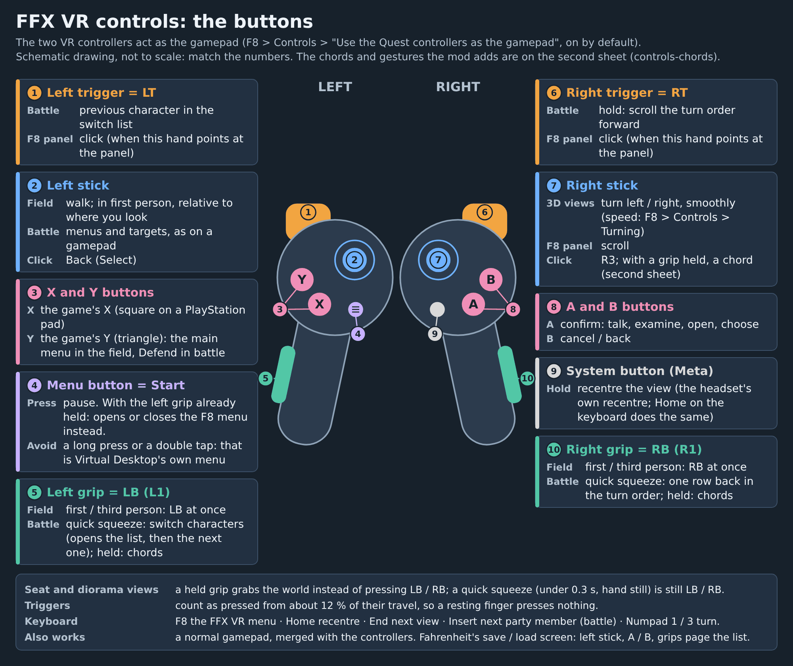
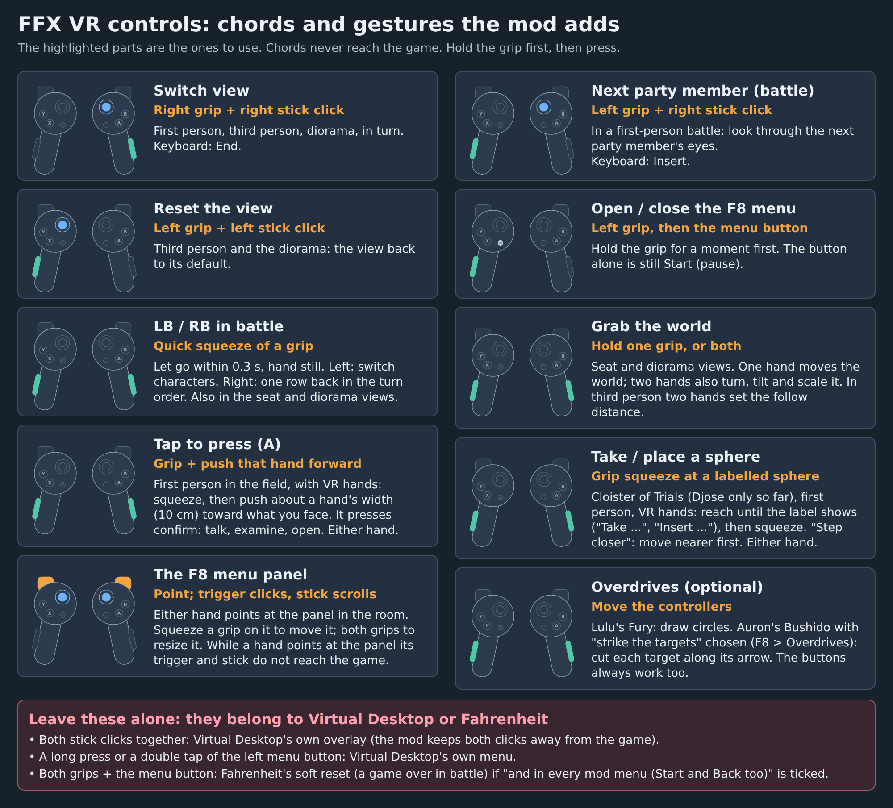

# FFX VR — alpha install guide

This guide is for building FFX VR from source with the scripts in `tools\`, which takes about
30–60 minutes the first time, mostly installing tools and waiting for builds. **Testers who just
want to play do not need it:** download the release zip from the
[Releases page](https://github.com/mrpapa987/ffx-vr/releases) and follow the `README.md` inside
(no build tools needed); [docs/tester-checklist.md](docs/tester-checklist.md) says what to try and
what to send back.

It has been developed and tested on one setup: Windows 11, an RTX 3080 Ti, and a **Quest 3
over Virtual Desktop (VDXR)**. Anything else is untested.

> An unofficial fan mod, not affiliated with Square Enix. You need your own copy of
> FINAL FANTASY X/X-2 HD Remaster on Steam. No game files are included.

---

## 1. What you need

### The game and the headset

| | Notes |
|---|---|
| **FINAL FANTASY X/X-2 HD Remaster** (Steam) | The current version, after the 1 October 2026 patch. Run it once normally before starting. |
| **A Quest headset + [Virtual Desktop](https://www.vrdesktop.net/)** | Virtual Desktop on the headset, and the **Virtual Desktop Streamer** on the PC. |
| **VDXR as the active OpenXR runtime** | In the Streamer app on the PC, choose **VDXR** as the OpenXR runtime. FFX is a **32-bit** program, so the 32-bit registration is the one that matters; the prerequisite check (step 3) shows it. SteamVR is not supported in this alpha. |

### Build tools (all free)

| Tool | Why | Install (winget IDs as of Oct 2026; or use the official installers) |
|---|---|---|
| Git | Downloading the source | `winget install Git.Git` |
| PowerShell 7 (optional) | Not needed: every command below uses Windows PowerShell (`powershell`), which comes with Windows | `winget install Microsoft.PowerShell` |
| Visual Studio **Build Tools 2026** | Building the C++ part of the mod (and, optionally, Fahrenheit from source) | `winget install Microsoft.VisualStudio.BuildTools`, then in the Visual Studio Installer tick **Desktop development with C++** and **.NET desktop build tools**; the **vcpkg** component only for building Fahrenheit from source |
| vcpkg integration | Only for building Fahrenheit from source (step 4, optional) | After the Build Tools install, run once in a *Developer* prompt: `vcpkg integrate install` |
| .NET 10 SDK | Building the mod | `winget install Microsoft.DotNet.SDK.10` |
| .NET 10 **x86** runtime | Running the mod (it's 32-bit, like the game) | `winget install Microsoft.DotNet.Runtime.10 --architecture x86` |
| 7-Zip | Only if you install a texture pack (optional, and not recommended without hardware stronger than an RTX 3080 Ti: step 7) | `winget install 7zip.7zip` |

---

## 2. Get the source

Clone the repository anywhere you like. Nothing in the scripts assumes a particular folder:

```
git clone https://github.com/mrpapa987/ffx-vr.git
cd ffx-vr
```

(While the repository is private, you need to have been invited as a collaborator.)

**Run every command below from this folder**, in PowerShell, **not as administrator**.
Fahrenheit refuses to start when elevated.

---

## 3. Check your setup

```
powershell -ExecutionPolicy Bypass -File .\tools\check-prereqs.ps1
```

This writes `logs\prereqs.txt` and prints the same report. Look for:

- **.NET**: a 10.x SDK and a 10.x **x86** runtime.
- **Visual Studio C++ tools**: found.
- **OpenXR runtime → 32-bit**: a path ending in `virtualdesktop-openxr-32.dll`. If it says
  *none registered*, set VDXR as the runtime in the Virtual Desktop Streamer.
- **Paths the tools will use → game**: your FFX install folder.

### If the game folder isn't found

The scripts find the game through Steam, including extra Steam library folders. If yours is
somewhere unusual, tell them where it is in either of two ways:

- for this PowerShell window only:
  `$env:FFXVR_GAME_DIR = 'D:\Games\FINAL FANTASY FFX&FFX-2 HD Remaster'`
- permanently: create `tools\paths.local.ps1` (it's not in git) containing one line:
  `$FfxvrGameOverride = 'D:\Games\FINAL FANTASY FFX&FFX-2 HD Remaster'`

The folder you give must contain `FFX.exe`.

---

## 4. Install Fahrenheit (the mod loader)

FFX VR runs inside [Fahrenheit](https://github.com/fahrenheit-crew/fahrenheit). FFX VR is
tested with the official Fahrenheit release **v1.0.0-alpha12**, the first release that works
with the October game patch (alpha11 and older don't).

1. Download `fahrenheit_release_v1.0.0-alpha12.zip` from its
   [releases page](https://github.com/fahrenheit-crew/fahrenheit/releases/tag/v1.0.0-alpha12)
   (under *Assets*). There's no need to extract it.
2. Install it:
   ```
   powershell -ExecutionPolicy Bypass -File .\tools\install-fahrenheit.ps1 -Zip <path to the zip>
   ```
   It empties `<game>\fahrenheit\bin`, copies the release in, makes sure `mods\loadorder`
   exists, and shows the version it installed, e.g.
   `Fahrenheit 1.0.0-alpha12 (7e85839, official release)`. It never touches your Fahrenheit
   config, saves or mods.

### Building Fahrenheit from source (optional)

Only for trying another Fahrenheit commit, or if the release zip is not an option. It needs
the vcpkg parts of step 1. It rewrites `_ext\fahrenheit\artifacts`, so it **replaces the build that
`install-fahrenheit.ps1` without `-Zip` installs**: if you keep an older source build there as a fallback,
back up `_ext\fahrenheit\artifacts\deploy\rel\bin` first.

```
powershell -ExecutionPolicy Bypass -File .\tools\build-fahrenheit-full.ps1
powershell -ExecutionPolicy Bypass -File .\tools\install-fahrenheit.ps1
```

- The first script clones Fahrenheit into `_ext\fahrenheit` and builds it, by default at the
  tested release (`-Commit <hash or tag>` picks another). It ends with **RESULT: OK** or
  **RESULT: FAILED** (exit code 1), below a list of the four loader files (`fhstage0.exe`,
  `fhstage1.dll`, `minhook.x32.dll`, `nethost.dll`). MSBuild itself may report exit code 1
  because it can't copy three debugging DLLs (`dbghelp.dll`, `dbgcore.dll`, `symsrv.dll`) when
  the Debugging Tools for Windows aren't installed; the script recognises exactly that and says
  so. `-Latest` builds Fahrenheit's newest code instead, which is untested with this mod.
- The second script (without `-Zip`) copies that build into `<game>\fahrenheit\` and says
  `built from source`.

---

## 5. Install the frame-rate mod (recommended)

FFX runs at 30 fps internally. [FFX-60fps](https://github.com/peternguyenst/FFX-60fps) draws
60 by smoothing between frames, which matters a lot in VR:

```
powershell -ExecutionPolicy Bypass -File .\tools\build-fps60.ps1 -Fps 60
```

`-Uninstall` removes it.

---

## 6. Build and install FFX VR

```
powershell -ExecutionPolicy Bypass -File .\tools\build-mod.ps1
```

This downloads the OpenXR loader from NuGet, builds both halves of the mod, copies them to
`<game>\fahrenheit\mods\ffxvr\` and adds `ffxvr` to Fahrenheit's load order. The Fahrenheit SDK
the mod builds against comes from nuget.org into `_ext\nuget` (`src\managed\nuget.config`), so
the first build needs the network; the build log names where each Fahrenheit package came from.
Run it again after every `git pull`. Your settings (`ffxvr.ini`) are kept. To reset them, delete `ffxvr.ini` with the game
closed (deleted while the game runs, it is written again at your next settings change). You can edit
`ffxvr.ini` while the game runs: it is read back within a second, and a bad value is ignored and listed in core.log.

---

## 7. Optional extras

| What | Command |
|---|---|
| **VR render resolution**: 2560×1440 instead of 4K; much lighter on the GPU. (Anti-aliasing is handled by the mod: 4× by default, in F8 > View > Graphics & performance) | `.\tools\game-settings.ps1 -Profile vr` (`-Profile flat` restores yours) |
| **Your existing saves**: Fahrenheit keeps its own save slots | `.\tools\import-steam-saves.ps1` copies your normal saves in (it never replaces a VR save unless you pass `-Force`); `.\tools\export-save-to-steam.ps1` copies one back |
| **Your own VR hands** from a model you own (Python 3 + numpy; README.md, "VR hands and your own hands"). The pack goes into the game's mod folder, never into this repository: the importer refuses a git checkout | `.\tools\import-hands.ps1 "<model>.obj" -Name mine` |

Prefix each with `powershell -ExecutionPolicy Bypass -File`.

### The Re-Remastered texture pack (optional; read the caution first)

- **Performance:** the pack caused performance problems in VR on the developer's PC (an RTX 3080 Ti). It is **not
  recommended unless your hardware is stronger than that.**
- **Disk space:** the Medium (2.5x) pack is about **18 GB** of loose files once installed, on top of the downloaded
  archive, which is a big download itself. `-Compress` turns on NTFS compression for the pack's folder, which roughly
  halves the installed size.

If you still want it: download it yourself from
[Nexus](https://www.nexusmods.com/finalfantasyxx2hdremaster/mods/244). Do **not** install its External File Loader;
Fahrenheit serves the files instead.

```
powershell -ExecutionPolicy Bypass -File .\tools\install-texture-pack.ps1 -Archive "<path to the .7z>" -Compress
```

`-Uninstall` removes it again.

---

## 8. Play

1. On the PC, start the **Virtual Desktop Streamer**. Put on the headset and connect to the
   PC in Virtual Desktop.
2. Launch the game **through Fahrenheit**, not from Steam:
   ```
   powershell -ExecutionPolicy Bypass -File .\tools\run-ffx.ps1
   ```
   This also collects the logs into `logs\` when the game closes, which is what to send with a
   bug report.
3. In the game, press **F8** for the FFX VR overlay. Tick **Headset** (top left), and View >
   Starting > **Start in the headset** if you want it on from the next launch.
4. The headset starts in the **seat** view (the game's own camera position, your head free to look around). Press
   **right grip + right stick click** (or **End**) for first person: your hands appear there. With "Start in the
   headset" ticked, the next launch starts in first person.
5. In the headset the F8 menu is a panel in the room. Open or close it from the controllers: hold the **left grip**,
   then press the **left menu button**. Point at it with either controller: the trigger clicks, the stick scrolls;
   squeeze a grip on it to move it. **Bring here** (or Home) puts it in front of you again.

### Virtual Desktop settings

- **Refresh rate: 120 Hz** (72 Hz also works). Avoid 90 Hz: 60 fps doesn't divide into it, and
  the game falls back to 30.
- **SSW (Synchronous Spacewarp): Disabled**, not "Always" (Auto is not tested with this build).
  The mod fills the refreshes between game frames itself, turned with the stick, so stick turns
  should be as smooth as head turns ("Extra-smooth stick turning (headset rate)" in F8 > Controls, on
  by default; the `sr:` lines in `ffxvr_diag.log` show what it does).
- Set the game's **V-Sync off** (the headset paces the frames).
- **Quit through the game's menu**, not by closing the window.
- Play **seated**.

### Controls

The Quest controllers act as the gamepad ("Use the Quest controllers as the gamepad" in F8 >
Controls, on by default). A normal gamepad works too.





| Action | Controllers | Keyboard |
|---|---|---|
| Recentre the view | Hold the **Meta** (system) button | **Home** |
| Turn | Right stick: smooth turning, at the turn speed set in F8 > Controls (there is no snap turning) | Numpad 1 / 3 |
| Change view: first person → third person → diorama | **Right grip + right stick click** | **End** |
| Reset the view (third person / diorama) | **Left grip + left stick click** | |
| Battle: look through the next party member | **Left grip + right stick click** | **Insert** |
| Battle: switch characters (LB) / scroll the turn order back (RB) | A **quick squeeze** of the left / right grip (in the diorama a held grip still grabs) | |
| Battle: Defend | **Y** | |
| Fahrenheit's save / load screen | Left stick, **A** / **B**, grips page the list | |
| The overlay (F8 menu) | Hold the **left grip**, then press the **left menu button** | **F8** |
| Seat and diorama views: grab the world | Hold a grip and move your hand; both grips also turn, tilt and scale | |
| First person, field: press confirm (A) by reaching | Squeeze a grip and push that hand forward about 10 cm ("tap to press action", F8 > Hands > gestures) | |
| Djose's cloister: take or place a sphere | Squeeze the grip of the hand at the labelled sphere or socket | |
| The F8 menu panel | Point at it; **trigger** clicks, **stick** scrolls; a grip on it moves it, both grips resize it | Mouse |

Leave these alone, they belong to Virtual Desktop: **both stick clicks together** (its overlay) and a **long press or
double tap of the left menu button** (its menu).

### What to expect

- **Field and battles**: first person (with your body hidden), third person behind the
  player, or a tabletop **diorama** you can grab and scale with the grips. In battle, first
  person follows whoever is on the field, and the summoner during a summon; the battle diorama
  is a table centred on the fight, and each battle starts from its default view.
- **Your hands**: in first person a pair of gloved hands at the controllers (VR hands, on by default
  when there is no `ffxvr.ini` yet; an `ffxvr.ini` kept from an earlier build keeps its own value: F8 >
  Hands > "VR hands: your own hands at the controllers"). In Djose's Cloister of Trials you take and
  place the spheres with them; the Destruction Sphere and the other cloisters still use the A button.
- **Overdrives**: F8 > Overdrives has the gestures (Lulu's Fury by circles; for Auron's Bushido choose
  "strike the targets"; "Practice targets" needs no battle).
- **Menus, dialogue, the battle command window**: on a panel in front of you.
- **2D screens and movies**: a large flat virtual screen.
- **Blitzball**: a large **stereo 3D screen** showing the game's own camera, with automatic
  depth. "everywhere" in F8 > Movies > 3D cinema screen uses this screen for the whole game
  instead.

---

## 9. When something goes wrong

| Symptom | Try |
|---|---|
| The game starts flat, nothing in the headset | Is Virtual Desktop connected *before* launch? Is **Headset** ticked in the F8 overlay? Does `logs\prereqs.txt` show VDXR as the 32-bit runtime? |
| Fahrenheit doesn't start at all | Not as administrator. Re-run `install-fahrenheit.ps1 -Zip <zip>` (step 4); it prints the installed version. Check `logs\run-*.txt`. |
| Fahrenheit starts but the mod doesn't load (no F8 overlay) | `<game>\fahrenheit\mods\loadorder` must list `ffxvr` on a line of its own; `build-mod.ps1` adds it. |
| Black for a few seconds at some scene changes | The headset should now keep showing the last picture (head-tracked) while the game loads. If it still goes black, send the logs: the `sr:` lines in `ffxvr_diag.log` say why. |
| Ghosting when turning with the stick | Is "Extra-smooth stick turning (headset rate)" ticked in F8 > Controls > Turning? Then the Virtual Desktop refresh rate and SSW, above. If the game drops below 60 fps, use `game-settings.ps1 -Profile vr`. |
| Blurry, or a lower resolution than usual | The F8 overlay says "Game renders at ..., below the headset's per-eye ..." when this is the cause. Two ways to get there: (1) the monitor was off or asleep when the game started: in fullscreen the game then only got Virtual Desktop's virtual display, often 1920x1080. Keep the monitor on when you start the game, raise the virtual display's resolution in the Virtual Desktop Streamer if your version offers it, or use a 4K HDMI/DisplayPort dummy plug. (2) The game's own resolution is set lower than the headset's per-eye size (for example 2560x1440 from `game-settings.ps1 -Profile vr` with a high Virtual Desktop quality preset): raise it with `game-settings.ps1 -Width 3200 -Height 1800`, or lower the quality preset. |
| Everything broke after a Steam update | A game patch moves the addresses Fahrenheit hooks. Wait for a Fahrenheit release that supports the new version (and an FFX VR update that names it). |

For a bug report (an issue in this repository, never on Fahrenheit's pages), send the newest
`logs\run-*.txt` and the `logs\run-*-gamelogs` folder next to it, plus a description of what you saw.
[docs/tester-checklist.md](docs/tester-checklist.md) lists what to try and what to send back.

### Logging

A fresh install logs little: `ffxvr_diag.log` (events and errors, per session, at most 4 MB; the
session before is `ffxvr_diag.prev.log`) and `ffxvr_native.log`. With the game closed:
`.\tools\set-logging.ps1 -Profile Verbose` only logs more (the periodic summaries and the load: lines; log cap
64 MB): that is the one to ask testers for. `.\tools\set-logging.ps1 -Profile Dev` turns on the developer's
diagnostics (also build-7's hooks and watchdog, the load profiler's sampler, battle-transition lines, the
HD-cache pool hooks and the ntdll reservation patch: they cost frame time and change how the game runs; the research
logs under F8 > Developer > Inspect, for spheres, weapons and battle commands, are separate switches it leaves alone) and
`.\tools\set-logging.ps1 -Profile Release` turns them all off again. Both edit `ffxvr.ini` in place and keep a
timestamped `.bak`. The F8 overlay's header shows an amber "log: N on" while any is on (hover it for the list).
