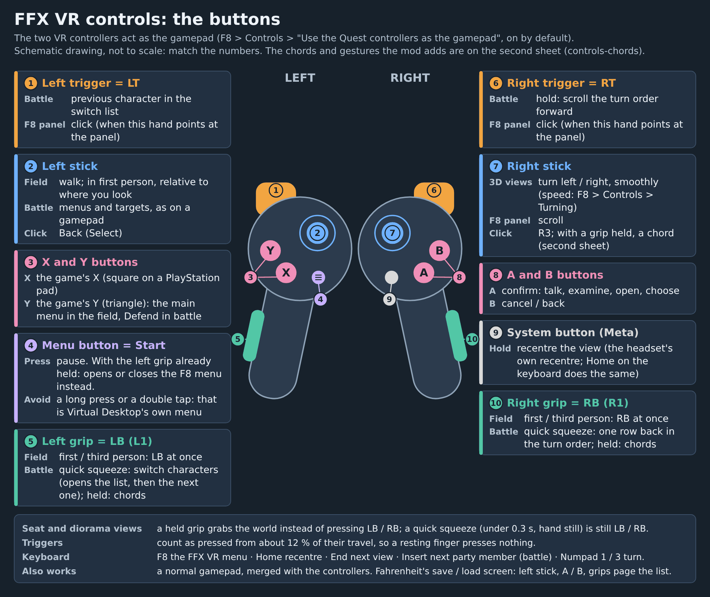
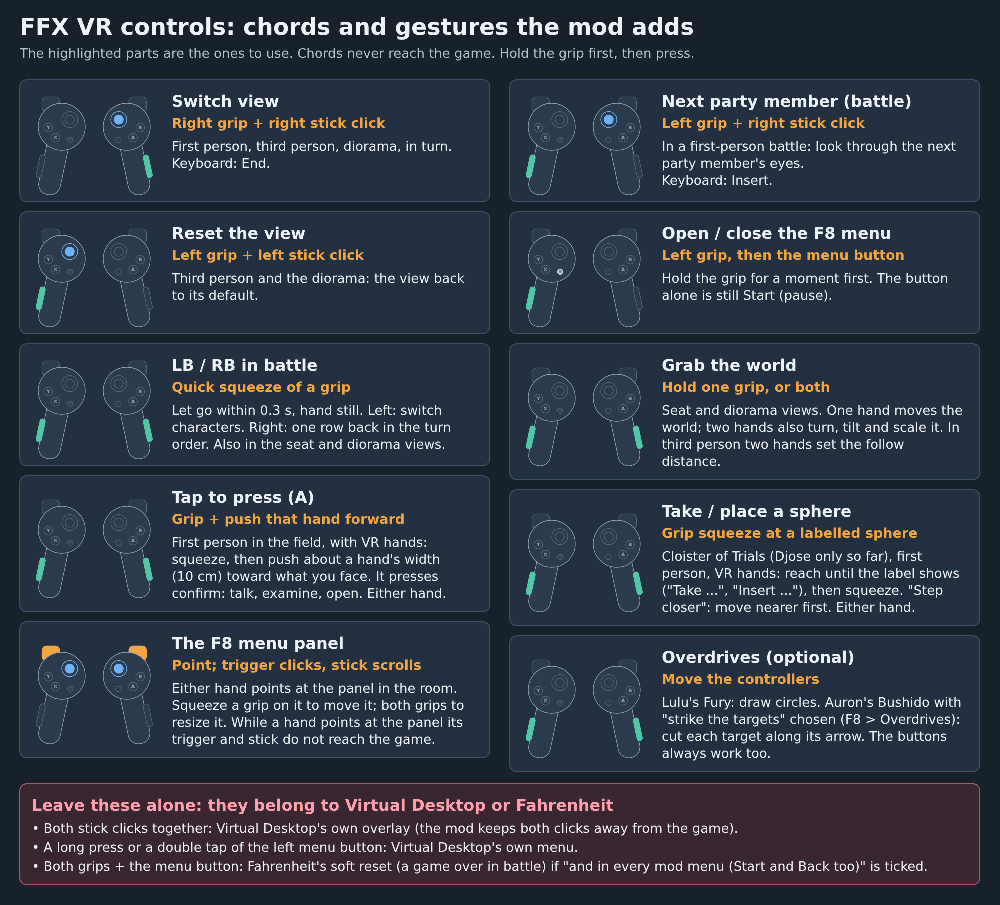

# FFX VR: tester checklist

Thank you for testing. FFX VR has been developed and tested on **one setup only** (Quest 3, Virtual Desktop with VDXR,
an RTX 3080 Ti), so what happens on yours is exactly what we need to know. This list is ordered most important first
and takes about an hour; if you only have 15 minutes, do the first section. You do not have to finish it: a report on
the part you did is worth more than no report.

Quoted names such as "Steady view during scripted moves" are the exact labels in the F8 menu. Every command is run from
the extracted `ffx-vr-<version>` folder (the one with `README.md` and `tools\` in it), in PowerShell, not as
administrator.

**Please test without the Re-Remastered HD texture pack first.** It caused performance problems on the developer's
RTX 3080 Ti and needs a lot of disk space (about 18 GB for the Medium pack); with it installed we cannot tell its cost
from the mod's.

## Write these down first (2 minutes)

- PC: GPU, CPU, Windows version.
- Headset, Virtual Desktop version, and its settings: **refresh rate** (120 Hz recommended, 72 Hz works, avoid 90 Hz),
  **SSW** (should be Disabled), quality preset, codec and bitrate if you changed them.
- OpenXR runtime (VDXR is the tested one; `tools\install-mod.ps1` prints what it finds).
- The game's resolution and V-Sync (should be off), whether FFX-60fps is installed and at what `fps=`, and whether a
  texture pack is installed.

## If you only have 15 minutes

1. **Install** on a game folder that has never had FFX VR (README sections 1 to 5):
   `powershell -ExecutionPolicy Bypass -File .\tools\install-mod.ps1`
   Copy everything it prints into your report. Right looks like: every `[checks]` line found (Fahrenheit
   `1.0.0-alpha12 (7e85839, official release)`, a .NET 10 x86 runtime, `OpenXR (32-bit)    : VDXR`), six files listed
   under `[install]` plus `hands\generic-glove\` and `hands\generic\`, `added 'ffxvr' to mods\loadorder`,
   `no ffxvr.ini yet`, then `Installed. Start the game with: ...`. A line saying the optional target art was not
   found is fine: it is a separate download.
2. **Copy your saves in** (game closed). Fahrenheit keeps its own save set, so without this the load screen is empty:
   `powershell -ExecutionPolicy Bypass -File .\tools\import-steam-saves.ps1`
3. **Start** with Virtual Desktop connected first:
   `powershell -ExecutionPolicy Bypass -File .\tools\run-ffx.ps1`
4. Load a save in the field. The FFX VR window is already open (**F8** hides and shows it): tick **Headset** (top
   left). The picture should appear in the headset, in 3D, and follow your head.
5. Press **right grip + right stick click** until you are in first person (the first view after ticking Headset is the
   seat view, the game's own camera position). Walk, turn with the right stick, look at your hands.
6. Get into one battle, win it, then quit **through the game's menu**.
7. Send the logs and your notes (the last section).

The five questions that matter most: Did it install without an error? Did the headset show the game in 3D? Was it
comfortable (smooth when you turn your head, smooth when you turn with the stick)? Did anything look wrong (say where)?
What does the frame / GPU line at the top of F8 say (see "Performance")?

## The full pass (about an hour)

### 1. Install (10 minutes)

As above. Also worth noting:

- Anything Windows asked on the way (SmartScreen, antivirus: the DLLs are not code-signed).
- Whether `install-mod.ps1` found the game by itself.
- Run `install-mod.ps1` a second time: it should say `'ffxvr' already in mods\loadorder` and change nothing else.

### 2. First run: what you should see (5 minutes)

- Without the headset ticked, the game plays on the monitor as usual.
- The FFX VR window is open when the game starts for the first time; **F8** hides it and shows it again. It has a header with **Headset**, **Recentre**, a status line, a frame / GPU / VRAM line
  and the version (`FFX VR 0.1.0-alpha.1+<commit>`), then the tabs **View, Controls, Battle, Overdrives, Movies,
  Hands**. There should be **no** amber "log: N on" in the header and **no** Developer tab.
- Tick **Headset**: the 3D picture appears in the headset at the next 3D scene. It starts in the **seat** view.
- In the headset the F8 menu is a panel in the room, about 1 m ahead. Hold the **left grip**, then press the **left
  menu button**: it closes; the same again opens it. Point at it with a controller: a beam and a dot; the **trigger**
  clicks, the **stick** scrolls. Squeeze a grip on it to move it; **Bring here** puts it back in front of you.
- View > Starting > "Start in the headset" makes the next launch go straight into the headset, in first person.
- Quit through the game's menu. When the game closes, `run-ffx.ps1` prints where it collected the logs.

### 3. Views and controls (10 minutes)

The two pictures show every button and chord (the files are in `docs\img\` if your viewer shows no pictures here):





Try each, and note any that does nothing or does the wrong thing:

- **Right grip + right stick click**: first person, third person, diorama, in turn (keyboard: End).
- **Right stick**: smooth turning. Is it as smooth as turning your head? (F8 > Controls > Turning > "Extra-smooth stick
  turning (headset rate)" is on by default.)
- Hold the **Meta** button (or press Home): the view recentres.
- **Diorama**: hold one grip and move your hand (the world moves); both grips: turn, tilt and scale it.
  **Left grip + left stick click** resets the view.
- **First person**: your own body is hidden, your shadow stays. Walking goes where you look.
- A menu (the game's main menu, a shop, dialogue): on a panel in front of you, readable.
- A save sphere: Fahrenheit's save / load screen works with the left stick, A / B, and the grips page the list.

### 4. Your hands (5 minutes)

In first person in the field (F8 > Hands > "VR hands: your own hands at the controllers" is on for a fresh install):

- A pair of dark gloved hands at your controllers. The fingers follow the trigger, the grip, and your thumb resting
  on the buttons or the stick. Are they where your real hands are?
- **Tap to press**: face a person or a chest, squeeze a grip and push that hand forward about 10 cm. It should press
  confirm (talk, open) with a short tick on that controller, and not while a text box is up.
- The hands are not drawn in battle, in menus or in movies: that is intended.

### 5. A battle (10 minutes)

- **First person**: you look through the eyes of a party member on the field; only your own character is hidden (F8 >
  View > First person > "Your body in battle" is "hide by model (only your own character)"). The other two party
  members and the enemies should all be visible for the whole battle, also while someone attacks.
- The battle command window is on the panel; the target cursor (a hand) is in 3D over its target.
- A **quick squeeze** of the left grip opens the switch list (the next squeeze: the next character); of the right
  grip: one row back in the turn order. **Y** defends. **Left grip + right stick click**: the next party member's eyes.
- **Diorama** (right grip + right stick click until you see the table): the table is centred on the fight (F8 >
  Battle > "Battle diorama: centre on the fight"), starts each battle at the default view looking from the party
  toward the enemies ("Battle diorama: start each battle from the default view"), and stays still while characters run
  in to attack. Move it with the grips: it should stay as you put it for that battle, and after the battle the field's
  diorama view should be as you left it before.
- If you have **Holy** (or any big spell, overdrive or aeon attack): cast it once in first person and once in the
  diorama. With F8 > Battle > "Characters a spell draws by itself" on "in 3D", the target and the effects should be in
  the 3D view and the battle menus should stay on their panel. Tell us which spell and what you saw.
- When the battle starts and ends: is the transition comfortable?

### 6. A Cloister of Trials: Djose (10 minutes, if you have a save there)

In first person, with VR hands on (F8 > Hands > "Grab spheres with your hands (Cloisters of Trials)"):

- Reach toward a sphere or an empty recess: a label appears near your hand ("Take ...", "Insert ...", "Empty recess",
  "Hands full"). "Step closer" means walk nearer first.
- With the label showing, squeeze that hand's grip: the sphere is taken or placed, and no prompt is left for you to
  answer. The carried sphere sits in your palm ("Carried sphere in your hand").
- "Fast sphere grab" (with its "speed" slider) makes the game's own animation pass quickly. Was it comfortable?
- The Destruction Sphere, and the other cloisters, still need the A button: that is known.
- If the game is not in English, the grip presses A once and the game's prompt shows as usual: that is known too.

### 7. Overdrives (5 minutes, optional)

- F8 > Overdrives > Bushido targets > **Practice targets** (headset on; no battle needed): targets appear in front of
  you, one at a time; cut each along its arrow with either hand. Are they at a comfortable place and height?
- For the real thing, "Auron's Bushido:" is on "strike the targets" for a fresh install; "Overdrives always ready"
  lets you use an overdrive in any battle (while it is ticked the gauge is not spent, so a save made then keeps a full gauge).
- Lulu's Fury: draw circles with a controller ("Lulu: circles for Fury"). With the optional art zip installed, a
  countdown bar sits above the ring: does it run down with the game's timer, and can you read it?
- Tidus's Swordplay with "Tidus: swing for Swordplay" ticked: with the art zip, the bar above your right hand is the
  ornate one (golden zone, two pointers pinching the cursor) and the game's own Swordplay bar is hidden from the next
  launch on ("Hide the game's Swordplay bar"). Can you time a swing by it? F8 > Overdrives shows under "Overdrive bar art
  (local pack)" whether the art loaded.

### 8. Without the headset, and uninstalling (5 minutes)

- Start the game with Virtual Desktop **not** connected: it should play on the monitor, with the FFX VR window there
  as before (F8 hides and shows it).
- `powershell -ExecutionPolicy Bypass -File .\tools\install-mod.ps1 -Uninstall` removes the mod and lists what it left
  (your settings and logs); add `-Purge` to delete those too. Does the game then start without FFX VR?

## Performance: what to record

At the top of the F8 overlay is one line like `frame 16.7 ms, GPU 9.8 of ~13.5 ms knee, vram 3400 / 11300 MB` (those
numbers are only an example). Hover it for the full text. Please record that line, and from the full text `extra
frames N/s`, `dropped (slots repeated) N/s` and `fresh frames late N%`, in three places:

1. standing in a town or village,
2. in a battle,
3. the heaviest place you found (say where).

With each: the view you were in, and the headset refresh rate. If the header shows an amber "Over the knee" warning,
or the picture is blurry and the header says "Game renders at ..., below the headset's per-eye ...", note that too.
If it struggles, try `powershell -ExecutionPolicy Bypass -File .\tools\game-settings.ps1 -Profile vr` (2560x1440
instead of 4K; `-Profile flat` puts your own setting back) and record the same three lines again.

## What to send back, and how

1. **The logs.** Start the game with `tools\run-ffx.ps1` every time. When the game closes it copies that run's logs
   into the `logs\` folder next to `tools\`: `logs\run-<date>-<time>.txt` (the console) and
   `logs\run-<date>-<time>-gamelogs\` (the mod's `ffxvr_diag.log` and `ffxvr_native.log`, Fahrenheit's logs,
   `fps60.log`, and a copy of your settings, `ffxvr.ini`). Zip the whole `logs\` folder.
2. **If you did not use `run-ffx.ps1`**: `ffxvr.ini` from `<game folder>\fahrenheit\mods\ffxvr\` as well (it holds the
   mod's settings only).
3. **What `install-mod.ps1` printed**, and your notes from "Write these down first" and "Performance".
4. **What went wrong, one item each**: where in the game, which view, what you did, what you saw, what you expected. A
   screenshot or a short clip from Virtual Desktop helps a lot for anything visual.

Send it as an issue at <https://github.com/mrpapa987/ffx-vr/issues>, with the zip attached: New issue > "Bug report",
one issue per problem. For your general notes use the same form and title it "Tester report". Never report FFX VR problems to the
Fahrenheit or FFX-60fps projects.

The logs name your game folder's path and describe your PC (GPU, Windows version, headset runtime); look through them
first if that matters to you.

**If we ask for a more detailed log**, with the game closed:

```
powershell -ExecutionPolicy Bypass -File .\tools\set-logging.ps1 -Profile Verbose
```

Play until the problem shows, quit through the game's menu, send the new `logs\run-*` files, then switch back (the
verbose log grows up to 64 MB a session):

```
powershell -ExecutionPolicy Bypass -File .\tools\set-logging.ps1 -Profile Release
```

The verbose log only writes more to `ffxvr_diag.log` in `<game folder>\fahrenheit\mods\ffxvr\`; it changes nothing
else about how the game runs.

**If the game crashes or freezes**: note what you were doing, and send the logs of that run all the same (`run-ffx.ps1`
still collects them once the game's window is gone; if it did not, send `ffxvr_diag.log` and `ffxvr_diag.prev.log`
from the mod folder and the newest folder under `<game folder>\fahrenheit\logs\`).
