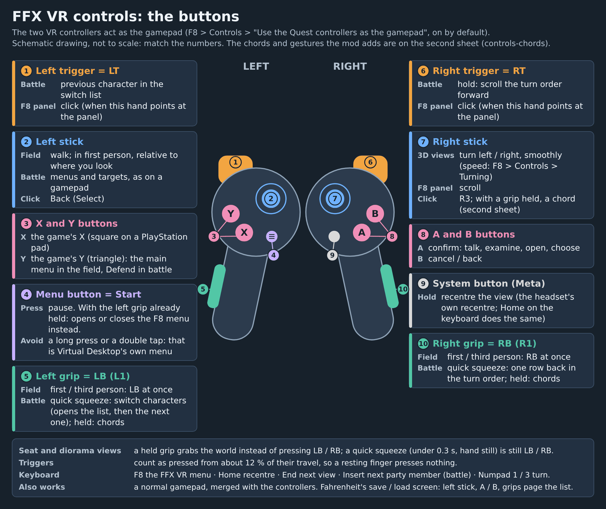
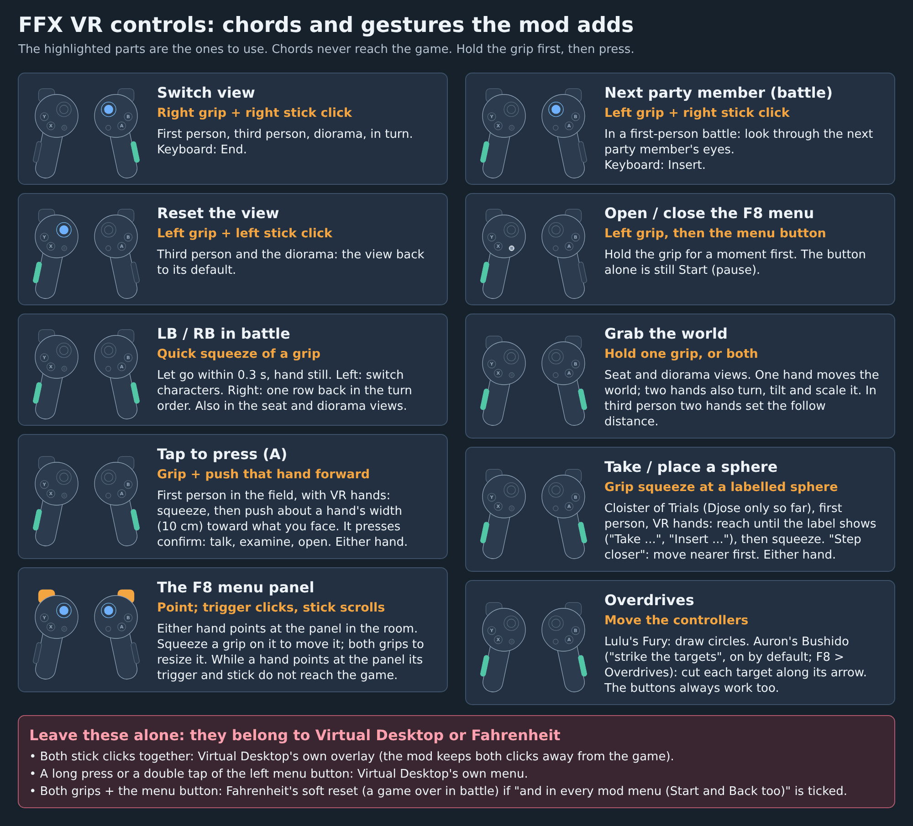

# FFX VR {VERSION}

VR for **FINAL FANTASY X HD Remaster** (Steam, PC). Alpha: expect rough edges.
Built from commit `{COMMIT}` on {DATE}.

Tested on one setup only: Windows 11, an RTX 3080 Ti, and a **Quest 3 over Virtual Desktop
(VDXR)**. Anything else is untested.

> An unofficial fan mod, not affiliated with Square Enix. You need your own copy of
> FINAL FANTASY X/X-2 HD Remaster on Steam. No game files are included.

---

## What's in this zip

| | |
|---|---|
| `mod\ffxvr\` | The mod itself (copied into the game folder by the installer) |
| `tools\install-mod.ps1` | Installs, updates or uninstalls the mod, and checks what's missing |
| `tools\run-ffx.ps1` | Starts the game through Fahrenheit and collects logs for bug reports |
| `tools\set-logging.ps1` | Turns the mod's verbose log on for a bug report (`-Profile Verbose`) and every diagnostic off again (`-Profile Release`) |
| `tools\game-settings.ps1`, `import-steam-saves.ps1`, `export-save-to-steam.ps1`, `install-texture-pack.ps1` | Optional extras (section 6) |
| `tools\import-hands.ps1`, `tools\hands\` | VR hands: make a hand pack from a model you own (section 6) |
| `docs\img\controls.png`, `controls-chords.png` | The controller diagrams: every button, and every chord and gesture the mod adds (section 5) |
| `TESTING.md` | For testers: what to try in about an hour, and what to send back |
| `LICENSE`, `THIRD-PARTY-NOTICES` | Licences (MIT for FFX VR; Apache-2.0 for the bundled OpenXR loader) |

Extract it **anywhere outside the game folder**, e.g. `Documents`. Inside you'll find a folder
`ffx-vr-{VERSION}` with this README and `tools\` in it. **Run every command below from that
folder** (open it in Explorer, then right-click an empty spot > *Open in Terminal*; on Windows 10,
Shift+right-click > *Open PowerShell window here*, or type `powershell` in Explorer's address bar
and press Enter), in PowerShell,
**not as administrator**: Fahrenheit refuses to start when elevated. Pick a folder whose name has
no `[` or `]` in it: Windows PowerShell may not run scripts from there.

---

## 1. What you need

| | |
|---|---|
| **FINAL FANTASY X/X-2 HD Remaster** (Steam) | The current version, after the 1 October 2026 patch. Run it normally once first. |
| **A Quest headset and [Virtual Desktop](https://www.vrdesktop.net/)** | Virtual Desktop on the headset, and the **Virtual Desktop Streamer** on the PC. |
| **VDXR as the OpenXR runtime** | In the Streamer app on the PC, choose **VDXR** as the OpenXR runtime. SteamVR isn't supported in this alpha. |
| **.NET 10 runtime, x86 (32-bit)** | `winget install Microsoft.DotNet.Runtime.10 --architecture x86`. The game is 32-bit, so the x86 one is the one that matters, even on 64-bit Windows. |
| **Fahrenheit** {FAHRENHEIT_RELEASE}, the mod loader | See section 2. |
| **FFX-60fps** (recommended) | See section 3. |
| **A GPU that renders the game twice per frame** | Tested on an RTX 3080 Ti only. `tools\game-settings.ps1 -Profile vr` (section 6) makes it much lighter. |

Not needed, and not recommended on that class of hardware: the Re-Remastered HD texture pack (section 6 says why).

---

## 2. Fahrenheit (read this first)

FFX VR runs inside [Fahrenheit](https://github.com/fahrenheit-crew/fahrenheit), a separate
project that isn't included in this zip. It installs into `<game folder>\fahrenheit\`. This
build was tested with Fahrenheit release **{FAHRENHEIT_RELEASE}** (commit `{FAHRENHEIT_COMMIT}`).
Older releases (alpha11 and earlier) do not work with the current game.

1. Download `fahrenheit_release_{FAHRENHEIT_RELEASE}.zip` from the
   [Fahrenheit releases page](https://github.com/fahrenheit-crew/fahrenheit/releases/tag/{FAHRENHEIT_RELEASE})
   (under *Assets*).
2. If you had Fahrenheit installed before, delete `<game folder>\fahrenheit\bin` (keep `config`,
   `mods`, `saves` and `state`).
3. Extract the zip so that its `bin` folder becomes `<game folder>\fahrenheit\bin`. Watch out:
   Explorer's *Extract All* suggests a new folder named after the zip
   (`...\fahrenheit\fahrenheit_release_{FAHRENHEIT_RELEASE}\bin`), so remove that last part of the
   path and extract to `<game folder>\fahrenheit\`.

`tools\install-mod.ps1` checks that `fahrenheit\bin\fhstage0.exe` is there and shows the
Fahrenheit version it found.

Developers can build Fahrenheit from source: see `INSTALL-ALPHA.md` in the
[FFX VR repository](https://github.com/mrpapa987/ffx-vr).

---

## 3. FFX-60fps (recommended)

The game runs at 30 fps. [FFX-60fps](https://github.com/peternguyenst/FFX-60fps) draws 60 by
smoothing between frames, which makes a big difference in VR. Install it per its own README
(its files go next to `FFX.exe`), with `fps=60` in its `fps60.ini`.

---

## 4. Install FFX VR

```
powershell -ExecutionPolicy Bypass -File .\tools\install-mod.ps1
```

It finds the game through Steam, checks the list in section 1, copies the mod into
`<game folder>\fahrenheit\mods\ffxvr\` and adds `ffxvr` to Fahrenheit's load order.

- **Game not found?** Tell it where the game is, either for this window only:
  `$env:FFXVR_GAME_DIR = 'D:\SteamLibrary\steamapps\common\FINAL FANTASY FFX&FFX-2 HD Remaster'`
  or permanently, by creating `tools\paths.local.ps1` containing the line
  `$FfxvrGameOverride = 'D:\SteamLibrary\steamapps\common\FINAL FANTASY FFX&FFX-2 HD Remaster'`.
  The folder must contain `FFX.exe`.
- **Updating:** extract the new zip and run its `install-mod.ps1`. Your settings
  (`ffxvr.ini`) are kept. To reset them, delete `ffxvr.ini` with the game closed.
  Because your settings are kept, a new default does not reach you by itself. VR hands were off by default before
  0.1.0-alpha.1: the installer says so when your kept `ffxvr.ini` still has them off; tick F8 > Hands > "VR hands: your
  own hands at the controllers" to turn them on.
- **Uninstalling:** `install-mod.ps1 -Uninstall` removes the mod and its load-order line and lists what is
  left (your settings and logs); `install-mod.ps1 -Uninstall -Purge` deletes those too.
- **Coming from a test build?** If your kept `ffxvr.ini` has diagnostics on, the installer says so:
  `install-mod.ps1 -ResetLogging` turns them all off (a backup is made first), and `-DeleteLogs` removes old
  big logs and captures from the mod folder.

---

## 5. Play

**Your saves first.** Fahrenheit keeps its own set of saves, so your normal saves do **not** show in the load screen
until you copy them in (game closed; your Steam saves are not touched):

```
powershell -ExecutionPolicy Bypass -File .\tools\import-steam-saves.ps1
```

Without it the load list is empty and you would have to start a new game.

1. On the PC, start the **Virtual Desktop Streamer**. Put the headset on and connect to the PC
   in Virtual Desktop.
2. Start the game **through Fahrenheit**, not from Steam:
   ```
   powershell -ExecutionPolicy Bypass -File .\tools\run-ffx.ps1
   ```
   Steam must be running. When the game closes, the script collects the logs into `logs\`.
3. The FFX VR window is already open when the game starts for the first time (**F8** hides and shows it; in the
   headset, the left grip held + the left menu button does the same). Tick **Headset** (top left), and View >
   Starting > **Start in the headset** if you want it on from the next launch.
4. The headset starts in the **seat** view (the game's own camera position, your head free to look around). Press
   **right grip + right stick click** (or **End**) for first person: your hands appear there. With "Start in the
   headset" ticked, the next launch starts in first person.
5. In the headset the F8 menu is a panel in the room. Open or close it from the controllers: hold the **left grip**,
   then press the **left menu button**. Point at it with either controller: the trigger clicks, the stick scrolls;
   squeeze a grip on it to move it. **Bring here** (or Home) puts it in front of you again.

Without a headset, or with Virtual Desktop not connected, the game plays normally on the monitor.

### Virtual Desktop settings

- **Refresh rate: 120 Hz** (72 Hz also works). Avoid 90 Hz: 60 fps doesn't divide into it.
- **SSW (Synchronous Spacewarp): Disabled**, not "Always" (Auto is not tested with this build).
  The mod fills the refreshes between game frames itself, turned with the stick, so stick turns
  should be as smooth as head turns ("Extra-smooth stick turning (headset rate)" in F8 > Controls, on
  by default; the `sr:` lines in `ffxvr_diag.log` show what it does).
- Set the game's **V-Sync off** (the headset paces the frames).
- **Quit through the game's menu**, not by closing the window.
- Play **seated**.

### Controls

The Quest controllers act as the gamepad (on by default; "Use the Quest controllers as the
gamepad" in F8 > Controls). A normal gamepad works too. Two pictures show everything; they are in this zip's
`docs\img\` folder if your viewer does not show them here.





| Action | Controllers | Keyboard |
|---|---|---|
| Recentre the view | Hold the **Meta** (system) button | **Home** |
| Turn | Right stick: smooth turning, at the turn speed set in F8 > Controls (there is no snap turning) | Numpad 1 / 3 |
| Change view: first person, third person, diorama | **Right grip + right stick click** | **End** |
| Reset the view (third person / diorama) | **Left grip + left stick click** | |
| Battle: look through the next party member | **Left grip + right stick click** | **Insert** |
| The overlay (F8 menu) | Hold the **left grip**, then press the **left menu button** | **F8** |
| Battle: switch characters (LB) / one row back in the turn order (RB) | A **quick squeeze** of the left / right grip (in the diorama a held grip still grabs) | |
| Battle: Defend | **Y** | |
| Seat and diorama views: grab the world | Hold a grip and move your hand; both grips also turn, tilt and scale | |
| First person, field: press confirm (A) by reaching | Squeeze a grip and push that hand forward about 10 cm ("tap to press action", F8 > Hands > gestures) | |
| Djose's cloister: take or place a sphere | Squeeze the grip of the hand at the labelled sphere or socket | |
| The F8 menu panel | Point at it; **trigger** clicks, **stick** scrolls; a grip on it moves it, both grips resize it | Mouse |
| Fahrenheit's save / load screen | Left stick, **A** / **B**, grips page the list | |

Leave these alone, they belong to Virtual Desktop: **both stick clicks together** (its overlay) and a **long press or
double tap of the left menu button** (its menu).

### What to expect

- **Field and battles**: first person (your body hidden), third person behind the player, or
  a tabletop **diorama** you can grab and scale with the grips. In battle, first person
  follows whoever is on the field, and the summoner during a summon; the battle diorama is a
  table centred on the fight, and each battle starts from its default view.
- **Your hands**: in first person a pair of gloved hands at the controllers (VR hands, on by default
  for a fresh install; never in battle, menus or movies). In Djose's Cloister of Trials you take and
  place the spheres with them: reach until a label shows, then squeeze the grip. The Destruction
  Sphere and the other cloisters still use the A button.
- **Overdrives**: the buttons work as always. F8 > Overdrives has gestures: Lulu's Fury by drawing
  circles, and Auron's Bushido by cutting each input's target with a blade in either hand ("strike the
  targets", on by default; "Practice targets" lets you try without a battle).
- **Menus, dialogue, the battle command window**: on a panel in front of you.
- **2D screens and movies**: a large flat virtual screen.
- **Blitzball**: a large **stereo 3D screen** showing the game's own camera, with automatic
  depth. "everywhere" in F8 > Movies > 3D cinema screen uses this screen for the whole game.

---

## 6. Optional extras

Prefix each with `powershell -ExecutionPolicy Bypass -File`.

| What | Command |
|---|---|
| **Lighter render resolution**: 2560x1440 instead of 4K, much easier on the GPU (the mod does its own anti-aliasing) | `.\tools\game-settings.ps1 -Profile vr` (`-Profile flat` puts yours back) |
| **Your existing saves**: Fahrenheit keeps its own save slots | `.\tools\import-steam-saves.ps1` copies your normal saves in (it never replaces a VR save unless you pass `-Force`); `.\tools\export-save-to-steam.ps1` copies one back |

### The optional Bushido target art

The Bushido targets are plain plates. A separate optional download on the same release page,
`ffxvr-target-art-{VERSION}.zip`, turns them into textured medallions.

1. Extract it into the folder that **contains** `ffx-vr-{VERSION}` (the folder you extracted this zip into), so that
   its files merge into this one. Watch out: Explorer's *Extract All* suggests a new folder named after the zip
   (`...\ffxvr-target-art-{VERSION}\`); remove that last part of the path. Right is: the file
   `ffx-vr-{VERSION}\mod\ffxvr\art\targets\frame.png` exists.
2. Run `tools\install-mod.ps1` again. It prints `art\targets\  (N files: the optional target art)` when it found the
   art, and `art\targets\  (the optional target art: not found, looked in ...)` when it did not.

The art was generated with Google Gemini and upscaled with Upscayl by the project
owner: it is **AI-generated**, no rights are claimed, and it is free to use (`ART-NOTICE.txt` in it says the same).
The mod works the same without it.

### VR hands, and your own hands

A pair of hands is drawn at your controllers in first person, fingers following the trigger, grip and touch sensors.
They are **on by default** for a fresh install (the F8 **Hands** tab's first checkbox, "VR hands: your own hands at the
controllers", turns them off). **hand model** picks the look: our generic
glove (the default) or bare hand, or a pack you made yourself (**rescan** after adding one).

To make your own from a character model you own (a Wavefront `.obj` with its `.mtl` and textures beside it, full body,
T or A pose, Y up), install [Python 3](https://www.python.org/downloads/) and numpy (the script tells you how), then:

```
powershell -ExecutionPolicy Bypass -File .\tools\import-hands.ps1 "<path to the .obj>" -Name mine
```

It writes the pack into the mod's `hands\mine\` folder; in game: F8 > Hands > hand model > rescan, pick it. Options
for a hand that comes out wrong are listed at the top of `tools\import-hands.ps1` (`-CutRight 0.095`, `-FlipLeft`,
`-Only right`, ...).

**Keep such a pack on your PC; do not share it.** It is made from someone else's model (a game's character, most
likely), so it is marked private, and the installer and the release tools never copy or delete it
(`install-mod.ps1 -Uninstall` keeps it; `-Purge` names it before deleting it).

### Later, if you like: HD textures

**Read this before you install it.** The
[Re-Remastered texture pack](https://www.nexusmods.com/finalfantasyxx2hdremaster/mods/244)
works with FFX VR, but:

- **Performance:** it caused performance problems in VR on the developer's PC (an RTX 3080 Ti). It is **not
  recommended unless your hardware is stronger than that.**
- **Disk space:** the Medium (2.5x) pack is about **18 GB** of loose files once installed, on top of the downloaded
  archive, which is a big download itself. `-Compress` turns on NTFS compression for the pack's folder, which roughly
  halves the installed size.

It is not needed, and best left until everything else works: it is one more thing to rule out when something goes
wrong. If you try it and performance suffers, `-Uninstall` removes it again.

Download it yourself (needs [7-Zip](https://www.7-zip.org/) installed), and **don't** install the External File Loader
that comes with it; Fahrenheit serves the files instead:

```
powershell -ExecutionPolicy Bypass -File .\tools\install-texture-pack.ps1 -Archive "<path to the .7z>" -Compress
```

`-Uninstall` removes it.

---

## 7. When something goes wrong

| Symptom | Try |
|---|---|
| The game starts flat, nothing in the headset | Was Virtual Desktop connected *before* launch? Is **Headset** ticked in the F8 overlay? Does `install-mod.ps1` show VDXR as the 32-bit OpenXR runtime? |
| Fahrenheit doesn't start at all | Not as administrator. Is Fahrenheit release {FAHRENHEIT_RELEASE} installed (section 2; `install-mod.ps1` shows the version it found)? Check `logs\run-*.txt`. |
| No F8 overlay | The mod didn't load: re-run `install-mod.ps1` and check the .NET x86 runtime. |
| Black for a few seconds at some scene changes | The headset should now keep showing the last picture (head-tracked) while the game loads. If it still goes black, send the logs: the `sr:` lines in `ffxvr_diag.log` say why. |
| Ghosting when turning with the stick | Is "Extra-smooth stick turning (headset rate)" ticked in F8 > Controls > Turning? Then the Virtual Desktop refresh rate and SSW, above. If the game drops below 60 fps, try `game-settings.ps1 -Profile vr`. |
| Blurry, or a lower resolution than usual | The F8 overlay says "Game renders at ..., below the headset's per-eye ..." when this is the cause. Two ways to get there: (1) the monitor was off or asleep when the game started: in fullscreen the game then only got Virtual Desktop's virtual display, often 1920x1080. Keep the monitor on when you start the game, raise the virtual display's resolution in the Virtual Desktop Streamer if your version offers it, or use a 4K HDMI/DisplayPort dummy plug. (2) The game's own resolution is set lower than the headset's per-eye size (for example 2560x1440 from `game-settings.ps1 -Profile vr` with a high Virtual Desktop quality preset): raise it with `game-settings.ps1 -Width 3200 -Height 1800`, or lower the quality preset. |
| Everything broke after a Steam update | A game patch moves the addresses Fahrenheit hooks. Wait for a Fahrenheit (and maybe FFX VR) update. |

**Testing this alpha?** `TESTING.md` in this folder says what to try and what to send back.

**Bug reports:** open an issue at the [FFX VR repository](https://github.com/mrpapa987/ffx-vr/issues)
(never on Fahrenheit's or FFX-60fps's pages), with the newest `logs\run-*.txt` and the `logs\run-*-gamelogs`
folder next to it (zipped), a description of what you saw and the FFX VR version ({VERSION}; also at the
top of the F8 overlay).

The mod logs little by default: `ffxvr_diag.log` in `<game folder>\fahrenheit\mods\ffxvr\` (events and
errors, started fresh each session, at most 4 MB; the session before is `ffxvr_diag.prev.log`). If you are
asked for more detail, with the game closed, turn on the verbose log (it only logs more; nothing else
changes):

```
powershell -ExecutionPolicy Bypass -File .\tools\set-logging.ps1 -Profile Verbose
```

then play until the problem shows, send the logs, and switch back (the verbose log grows up to 64 MB a
session):

```
powershell -ExecutionPolicy Bypass -File .\tools\set-logging.ps1 -Profile Release
```

---

FFX VR is MIT-licensed; see `LICENSE`. The bundled OpenXR loader is Apache-2.0; see
`THIRD-PARTY-NOTICES`, which also credits the projects FFX VR builds on.
